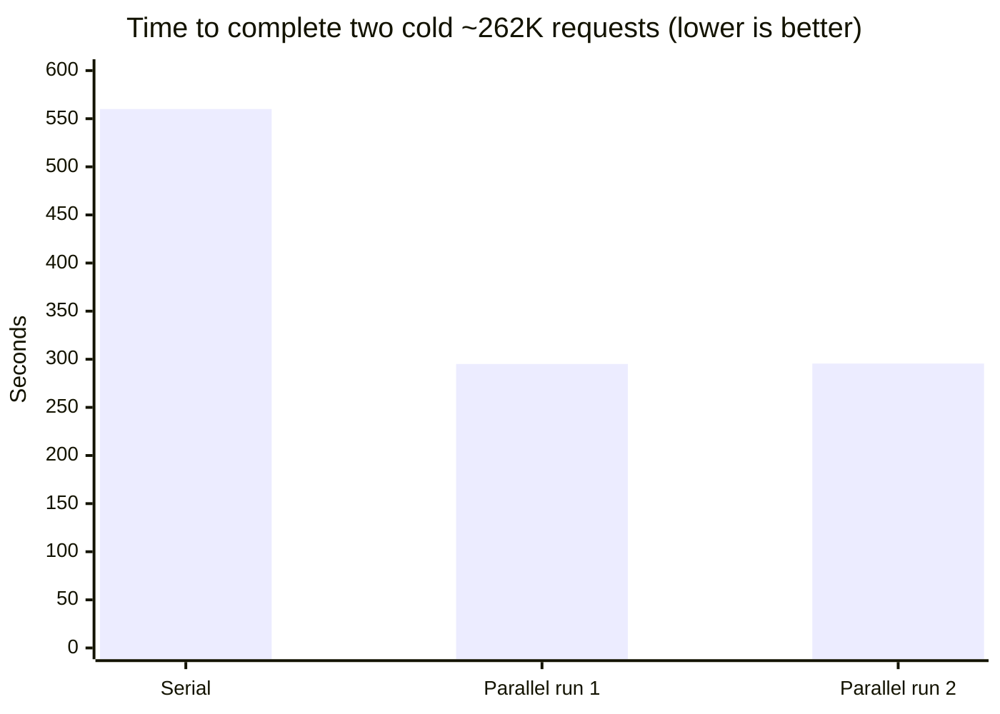

# Qwen3.8-27B Serving with Elpis

A serving recipe for **Qwen3.8-27B** built on **Elpis**, with **262K text context**, cache-aware request routing, image and document service integration, and automatic engine recovery.

The reference deployment runs two independent text engines on **2 × RTX 3090 (24 GiB each)** with a **32 GB RAM host**. GPU1 is shared with the separate image and document backends.

**Credit:** the inference engine and its optimizations are [Elpis](https://github.com/gildrb/elpis), by **Gil Rodrigues / gildrb**. This recipe adds deployment and service orchestration around Elpis. It does not claim authorship of Elpis's kernels, DFlash2 implementation, quantization, or native long-context support.

Reference upstream revision: [`13e8b593ea4c65f605b5fe7ac7d5ebb7a24f3c19`](https://github.com/gildrb/elpis/tree/13e8b593ea4c65f605b5fe7ac7d5ebb7a24f3c19). Measurements below were recorded on October 29–30, 2026; implementation inspected November 5, 2026. “Original Elpis” means that pinned revision, not the latest upstream release.

## What changed, and why it helps

| Area | Original Elpis / starting point | This recipe | Practical benefit and trade-off |
|---|---|---|---|
| GPU topology | One text engine on one RTX 3090 | One complete engine on each GPU; one active generation per engine | Two independent jobs can run concurrently. This is not tensor parallelism and does not double single-request speed. |
| Request routing | Direct access to a text engine | A local router with health checks, per-engine admission, and conversation affinity | Clients use one endpoint; repeat turns preferentially reuse the engine holding their prefix cache. |
| Clients without affinity headers | Our initial router balanced requests without recognizing the conversation | Derive an affinity key from the model and first two messages when no explicit header is supplied | Avoid unnecessary lane switching and repeated prefill. Affinity is best-effort, not a guarantee; availability and shared conversation prefixes matter. |
| Image requests | Elpis text serving path | Route images to a separate local Ollama vision model | One API can serve text and images. Vision is not added to Elpis itself, and its context limit is separate. |
| GPU sharing | No LLMRig media coordination | Reserve GPU1, wait for its text work, stop lane1, run media, then restore Elpis | Reuse the same hardware for text and media while lane0 remains available. Lane1's warm cache and second text slot are unavailable during media work. |
| Multi-request media work | Per-request model transitions | Exclusive media sessions with idle and maximum-duration limits, cleanup, and startup recovery | Keep the media model loaded across a document/session rather than switching for every page. No quantified speedup is claimed for this addition. |
| Auxiliary APIs | Separate application services | Routes for PDF/MinerU, OCR, transcription, embeddings, and auxiliary health | Existing local services share a gateway. Their models and servers remain separate dependencies. |
| Sampling | Greedy Elpis text generation | Preserve greedy text; expose a separate `qwen3.8-27b-sampled` Ollama profile | Stochastic generation is available without changing Elpis's decoder. This profile uses a different backend and a 65,536-token context. |
| Observability | Engine-local information | Usage JSONL, active-request tracking, GPU/RAM telemetry, slot availability at `/props` | Distinguish cache misses, waiting/prefill, and generated token counts. Stream timing is router-observed and is not a pure GPU decode benchmark. |
| Terminal failures | Manual intervention for sticky native-generator failure | A separate recovery service confirms the failure and restarts only the failed, idle engine | Reduce manual recovery while preserving healthy engines. It never replays inference requests and does not prevent OOM. |
| Host RAM | Upstream EXL3 entrypoint enables an 8 GiB host KV page tier | Disable the additional tier; retain GPU prefix cache and existing recurrent-state cache | Leave RAM for two engines and application services. A local 2 GiB tier experiment showed no meaningful TTFT benefit for the tested workload. |
| Build and deployment | Upstream build/launch defaults | Lower build concurrency, serialize base fetching, pin the image, verify model hashes, use systemd and container limits | Fit the host's memory budget and detect accidental engine/model changes at startup. |

## Before / after: measured results

These are **three different comparisons**. Do not combine them into a single speedup claim.

### 1. Previous LLMRig engine → Elpis adoption

Same 262,000-token input and 128-token output budget. The previous engine used two GPUs with EXL3 3.5 bpw, Q4 KV, and MTP; Elpis used one GPU with EXL3 4 bpw, Q3 KV, and DFlash2. The previous engine produced 123 tokens; Elpis produced 128.

| Metric | Previous LLMRig TP2 engine | Elpis, single GPU | Observed change |
|---|---:|---:|---|
| Time to first token | 423.83 s | 292.60 s | About 31% less waiting |
| Decode | 50.04 tokens/s | 92.14 tokens/s | About 1.84× decode rate |
| Total request duration | 426.27 s | 293.98 s | About 31% shorter; about 1.45× request speed |

**This improvement belongs to adopting Elpis and changing the deployment/precision profile, not to new kernels written for this recipe.** It is not an equal-precision benchmark, a quality-equivalence claim, or a comparison against every other engine.

### 2. Two Elpis requests: serial → independent parallel engines

Two cold requests, each approximately 262K input tokens with a 128-token output budget, through the production API. All reported `cached_tokens` values were zero. Both GPUs were used in the serial run too, one after the other.

| Execution | Time to finish both requests |
|---|---:|
| Serial | 560.02 s |
| Parallel, run 1 | 295.12 s |
| Parallel, run 2 | 295.51 s |

The ratio of serial duration to mean parallel duration is **1.90×**, for this two-job workload. It is a concurrent-job completion improvement, not a 1.90× speedup for one request. GPU power limits differed: GPU0 350 W, GPU1 420 W. They were not changed for this experiment.

### 3. Our initial router → automatic conversation affinity

The initial router already supported explicit affinity headers. A client sending none alternated between lanes, leaving each lane's cache behind the conversation. The November 1 operational investigation recorded approximately 15.6K uncached tokens and 20–25 seconds per turn before the fix; later observations showed approximately 300–800 uncached tokens and 2–3 seconds per turn. Six synthetic test requests stayed on the same lane, followed by confirmation on the real client.

This is an **operational observation from different turns**, not a controlled replay with identical prompts. It demonstrates the cache-routing problem and fix; it is not a general model-speed benchmark. The previously displayed low end-to-end token rate included repeated prefill.

Full local measurement notes, conditions, and limitations: [RESULTS.md](RESULTS.md) and [RESEARCH.md](RESEARCH.md). Original experiment artifacts are referenced there by host-local path and are not bundled with this recipe.

## What remains upstream, and what is disabled

The Qwen3.8-27B EXL3 4 bpw target, DFlash2 draft, Q3 KV cache, 262,144-token context, 270,336-token GPU cache pool, and inference optimizations come from upstream. The inspected Elpis checkout differs in only four build/launch files; the running container's `serve/exl3_server.py` hash matches that source checkout.

Local upstream adaptations are documented in [build-32gb.patch](build-32gb.patch): build `MAX_JOBS` reduced to 2, a base-fetch lock, and `--cpu-cache-gib 0`. The launch profile also sets `QWEN_PREFIX_PERSIST=0`; GPU prefix caching remains enabled. These are configuration choices, not removal of upstream cache implementations.

Unsupported target/draft device splitting and an inconclusive larger-prefill-chunk experiment were not adopted. No fine-tuning, new model weights, new inference kernels, or tensor-parallel Elpis implementation is claimed here.

## Using this recipe

This is a **reference deployment**, not a portable one-command installer. The files retain the tested host's paths, local image digest, model names, and service dependencies so the recorded setup is explicit.

1. Read the pinned upstream [Elpis build and model-preparation instructions](https://github.com/gildrb/elpis/tree/13e8b593ea4c65f605b5fe7ac7d5ebb7a24f3c19). Obtain the target/draft models under their respective terms. This recipe does not distribute models or the local Docker image.
2. Review and adapt `build-32gb.patch` for your build paths. Build from the pinned inputs; record your own verified image identity rather than treating this host's digest as a downloadable image.
3. Adapt absolute paths, UID/GID, GPU assignments, ports, model directories, and image identity in `compose.yaml`, `router.json`, `start.sh`, the recovery script, and both systemd units. Provision an API-key file separately; no credential is included.
4. Review dependencies before launch: the current startup expects the local Ollama container; PDF, extension, and Contest services are separate projects. Merely copying this directory does not install those services. Provision them for the features you intend to use, or adapt the integration explicitly.
5. Start only after checking GPU ownership and existing workloads. Run `doctor.py`, inspect both lane health states, and validate your own requests. The historical measurements are not certification for a different machine or workload.

For an offline router check, install `pytest` and run `python3 -m pytest -q test_router.py` from this directory. Publication validation: **19 tests passed**. This does not run GPU inference or certify the optional auxiliary services.

`compose.yaml`, `router.py`, and `media_session.py` implement the core deployment and routing. `recovery.py` is a separate monitor; its policy and installation details are described in [RECOVERY.md](RECOVERY.md). `configure_contest.py`, `contest-worker.conf`, and `rollback.sh` are host/application-specific integration helpers and must be reviewed before use.

The text API is `http://127.0.0.1:11446/v1`, with model `qwen3.8-27b`. Text context is **262,144 tokens per lane**, including prompt/template and output budget; the two limits are not additive. The Ollama vision/sampled profile has **65,536 tokens**. Media transitions temporarily reduce text concurrency to one lane and discard lane1's warm cache.

## Credits and attribution

- **[Elpis — Gil Rodrigues / gildrb](https://github.com/gildrb/elpis):** inference implementation, optimizations, DFlash2 serving integration, proof/validation work, and upstream build/model tooling. The pinned upstream code is MIT-licensed; its copyright and license notice are preserved in [UPSTREAM-LICENSE.txt](UPSTREAM-LICENSE.txt). See upstream [third-party notices](https://github.com/gildrb/elpis/blob/13e8b593ea4c65f605b5fe7ac7d5ebb7a24f3c19/THIRD-PARTY.md) for dependencies.
- **Qwen and the model/quantization publishers:** the underlying model and target/draft artifacts referenced by upstream. Model licenses remain separate from this deployment recipe.
- **ExLlamaV3 and DFlash2 contributors:** the underlying inference and speculative-decoding work used by Elpis; attribution and dependency versions are recorded upstream.
- **Ollama and MinerU contributors:** the separate serving/document tools used by the optional local integrations.
- **LLMRig / saitakarcesme:** this deployment recipe, dual-engine orchestration, cache-aware gateway, media coordination, telemetry, recovery integration, and local measurements.

The original LLMRig recipe code and documentation are provided under the [MIT License](LICENSE). Elpis retains its separate copyright notice in [UPSTREAM-LICENSE.txt](UPSTREAM-LICENSE.txt); model and dependency licenses are unchanged.

This is an independent integration recipe, not an official Elpis release or an upstream endorsement.

---

## Original operator notes (Turkish)

Bu recipe, iki RTX 3090 üzerinde iki bağımsız Qwen3.8-27B EXL3 + DFlash2 motoru çalıştırır. Model ağırlıkları 4 bpw, KV cache Q3; her motorun toplam context sınırı 262.144, cache havuzu 270.336 tokendır. Tek motor içindeki tensor parallelism kullanılmaz.

Contest Forge, tek koordinatör altında en fazla iki ayrı işi yürütür. Aynı işin istekleri mümkün olduğunda aynı motora gider; GPU prefix cache böyle korunur. Boş olmayan motora ikinci üretim verilmez. Başarısız bir POST otomatik başka motorda tekrarlanmaz.

## Uç noktalar

- OpenAI API: http://127.0.0.1:11446/v1 ; eski OpenAI gateway adresi http://127.0.0.1:11445/v1 aynı router'a bağlıdır.
- Model: qwen3.8-27b; qwen3.8:27b gelen isteklerde uyumluluk adı olarak çevrilir.
- Sağlık: http://127.0.0.1:11446/health ; iki motorun ayrı sağlık/meşgul bilgilerini verir.
- Her motorun gerçek /v1/models cevabı ayrıca 262144 bildirir. Context, şablon dahil girdi ve çıktı bütçesinin toplamıdır. Contest'in 8192 çıktı bütçesi için girişe en fazla kalan alan ayrılabilir; aşım sessiz kesilmez, HTTP 400 döner.
- Elpis greedy çalışır: temperature=0. İstemci timeout'u 7200 saniyedir.
- `/props` canlı GPU toplam/kullanılan/boş MiB değerlerini (en fazla 5 saniyelik cache), iki metin slotunun sağlık/meşgul/kullanılabilirlik durumunu ve ayrı context sınırlarını döndürür. Anlık kullanılan context token sayısı backend tarafından sunulmadığı için `null` kalır. Bellek ölçümü tahsis garantisi değildir.
- Metin örnekleme sınırı: `temperature=0`, `top_p=1`, `presence_penalty=0`; `top_k` alanı ve sıfırdan farklı presence penalty desteklenmez. İstenen stochastic değerler sessizce yok sayılmaz; HTTP 400 döner. Görsel Ollama profili ayrı sampling davranışına sahiptir.
- Görsel inceleme: `/v1/chat/completions` üzerinde aynı `qwen3.8:27b` veya `qwen3.8-27b` adıyla `image_url` içeren istekler yerel `Qwen3.8-27B-Uncensored:homelab-q4-64k` Ollama modeline gider. Base64 JPEG içerik parçaları korunur. Modelin görsel bileşenleri Ollama tarafından yüklenir; Elpis metin motoruna vision tower eklenmiş değildir. Görsel profil 65.536 context, metin profili 262.144 context kullanır. Görsel profilin quantization biçimi Q4_K_M'dir.
- `qwen2.5vl:3b` ile mevcut Contest görsel doğrulaması da korunur. `/api/chat`, `/api/generate` ve OpenAI chat görsel yolları, NDJSON/SSE akışı dahil desteklenir. Eski 11434 portu aynı router'a bağlıdır. Model yükleme/silme gibi Ollama yönetim uç noktaları açılmaz.
- MinerU `/v1/documents` yükleme, durum, dosya ve ZIP indirme yolları 11445 üzerinde geri getirilmiştir; PDF servisi 11447'de kalır. 100 MiB dosya sınırı korunur.
- PDF ve görsel işler `pdf-api/gpu-switch.lock` kilidini ikinci Elpis motoruyla paylaşır. İkinci motorda yürüyen üretim bitmeden model durdurulmaz. Medya işi sırasında birinci motor hizmet verir; iş bitince ikinci motor geri yüklenir. Normal metin işlerinde iki Elpis motoru ve mevcut model/KV/context ayarları korunur. Medya işi boyunca iki metin işinin paralel kapasitesi ve ikinci motorun sıcak cache'i korunamaz.
- Servis bakımı öncesi hem üretim istemcileri hem PDF kuyruğu boşaltılmalıdır; çalışan PDF sırasında Elpis servisini yeniden başlatmayın.

## Servis yönetimi

Recipe dizininde:

    python doctor.py
    systemctl --user status llmrig-elpis
    journalctl --user -u llmrig-elpis -n 40
    docker logs --tail 30 llmrig-elpis-lane0
    docker logs --tail 30 llmrig-elpis-lane1

Üretim işlerini durdurmadan motoru yeniden başlatmayın. Worker SIGTERM aldığında yeni iş almayı bırakır ve yürüyen işlerin bitmesini bekler. İki üretim motoru ve Contest'in tek koordinatörü birlikte bu recipe'yi oluşturur; ikinci bağımsız worker süreci açılmaz.

Geri dönüş için rollback.sh önce worker/scanner'ı durdurur, Elpis servisini kapatır, eski yerel yapılandırmayı geri getirir ve eski motor sağlıklı olduktan sonra istemcileri açar. Yeni yapılandırma silinmez, araştırma yedeğine taşınır. Önceki motorun host /dev/shm sorunu için oluşturulmuş geçici private-IPC drop-in'i aynı oturumda geri dönüşü destekler; bu runtime drop-in yeniden başlatmada kaybolur.

## Dosyalar ve kaynaklar

compose.yaml motorları GPU0/GPU1'e sabitler ve bellek sınırlarını belirler. router.py iş yönlendirmesi ve görsel GPU rezervasyonunu yapar. configure_contest.py yalnız model, iş paralelliği ve yerel görsel yönlendirme alanlarını değiştirir; diğer ayarları korur.

Model dosyaları /home/isa/models/elpis-262k altında; derleme cache'i ve API anahtarı /home/isa/.local/share/llmrig-elpis altındadır. Anahtar raporlara ve Git'e dahil edilmez.

Motor image ID'si start.sh içinde sabitlenmiştir. Motor ve model kimlikleri engine-provenance.json ile upstream manifestlerinde kayıtlıdır. start.sh her başlangıçta model dosyalarının hash kontrolünü yapar. Sunucu ayrıca motor variant/admission kontrolünü çalıştırır. Yeni image üretmek mevcut image ID'sini otomatik onaylamaz.

İlk image'ın doğrulanmış build kaynakları /home/isa/Experiments/elpis-comparison-20261029/elpis altında tutulur. Kaynak commit engine-provenance.json içinde; LLMRig'in yalnız build/launch uyarlamaları build-32gb.patch içindedir. Yeniden derleme, aynı araştırma dizinindeki build-images.sh ve kilitli girdilerle yapılabilir. upstream docker/build-exl3.sh için Bend artefaktları ve içerik manifestleri korunmuştur.

## Bellek bütçesi

İki motorun her birinde en fazla 4 GiB recurrent-state cache kullanılır. Ek host KV page tier kapalıdır: 2 GiB A/B/A deneyinde 308 sayfa geri yüklenmesine rağmen ilk token süresi iyileşmedi. Her motorun konteyner bellek sınırı 11 GiB; ana sistem, masaüstü, Contest ve sandbox süreçleri için pay bırakılır. Swap hızlandırma katmanı sayılmaz.

## Ölçümler

Ayrıntılı araştırma ve seçim gerekçesi RESEARCH.md içindedir. Ham deneyler /home/isa/Experiments/elpis-dual-262k-20261029/results altında tutulur. İki GPU sonucu tek istekte iki kat hız anlamına gelmez; tek istek gecikmesi, decode hızı ve iki isteğin toplam tamamlanma süresi ayrı ölçülür. Kaynak projelerin kısa context sayıları bu ölçümlere karıştırılmaz.
